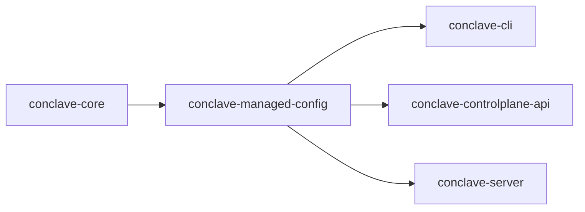

# Managed Configuration

`conclave-managed-config` is the Rust crate that defines Conclave's typed managed-configuration model and loads managed configuration from Styx text or directory-based Styx bundles.

It is used when operators or other Conclave software items need one canonical representation of declarative control-plane state before validation, planning, apply, or server bootstrap.

## Responsibilities

- Define the typed managed-configuration data model for action catalogs, templates, roles, tenants, subjects, memberships, and assumption grants.
- Parse managed configuration from Styx text.
- Assemble one managed bundle from multiple `*.styx` fragments in a directory.
- Generate a schema for the canonical managed-configuration shape.

Out of scope:

- applying managed configuration to the control plane
- serving HTTP APIs
- evaluating runtime authorization decisions

## Public Interface

Primary entry points:

- `ManagedConfig::load_from_str`
  - Parse one managed configuration document from Styx text.
- `ManagedConfig::load_from_dir`
  - Load and merge one directory of managed configuration fragments.
- `ManagedConfig::schema`
  - Generate the Styx schema for the canonical managed-configuration root type.

Primary exported config types:

- `ActionCatalogConfig`
- `TemplateConfig`
- `RoleConfig`
- `TenantConfig`
- `SubjectConfig`
- `MembershipConfig`
- `AssumptionGrantConfig`
- `LoadedManagedConfig`

## Relationships

### Dependency Summary

| Software item | Relationship |
| --- | --- |
| `conclave-core` | Provides shared IDs, keys, and other core value types used by managed configuration. |

### Dependent Summary

| Software item | Relationship |
| --- | --- |
| `conclave-cli` | Loads managed config bundles from the current directory for validate, plan, and apply workflows. |
| `conclave-controlplane-api` | Reuses `ManagedConfig` in request and response types for control-plane operations. |
| `conclave-server` | Loads managed config during startup and uses it for bootstrap and managed-state workflows. |



## Usage

Use `load_from_str` when the caller already has one complete managed-configuration document in memory.

```rust
use conclave_managed_config::ManagedConfig;

let managed = ManagedConfig::load_from_str(
    r#"
catalog {
    actions (
        {name "tenant:user:read"}
    )
}
tenants (
    {id "root"}
)
"#,
)?
```

Use `load_from_dir` when managed configuration is organized across multiple Styx fragments.

```rust
use conclave_managed_config::ManagedConfig;

let loaded = ManagedConfig::load_from_dir("config")?;
let managed = loaded.managed;
let source = loaded.source;
```

Use `schema` when tooling needs the canonical Styx schema for this software item.

```rust
use conclave_managed_config::ManagedConfig;

let schema = ManagedConfig::schema();
```

## Running

This software item is a library crate and is not run directly as its own process.

It is exercised through other software items:

- `conclave-cli`
  - `validate`, `plan`, and `apply` load managed config from the current working directory.
- `conclave-server`
  - startup loads managed config from the configured managed-config directory before building runtime state.
- tests in this crate and in downstream crates

## Testing

Run this software item's crate-local tests with:

```sh
cargo test -p conclave-managed-config
```

Coverage shape:

- Direct coverage
  - This crate's direct tests focus on parsing and deterministic fragment assembly.
- Indirect coverage
  - Broader behavior is also exercised by downstream consumers such as `conclave-server` and `conclave-controlplane-api`.

## Behavior Notes

- `load_from_dir` reads `*.styx` files in sorted filename order.
- `load_from_dir` ignores `server.styx` so server runtime config can live beside managed config without becoming part of the managed bundle.
- Directory fragments are merged into one canonical root shape before validation or use.
- A managed bundle must contain a `catalog` block.

## Traceability And Related Docs

- [Managed configuration spec](../../docs/spec/managed-configuration.md)
- [Repository traceability guidance](../../docs/traceability-guidance.md)
- [Project nomenclature](../../docs/nomenclature.md)
