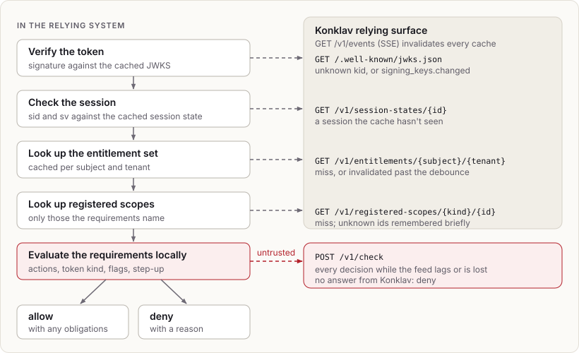

# Entitlements and decisions

## Entitlement set

```
EntitlementSet {
  subject, tenant, revision,
  global:  Set<Action>,                  // from global assignments
  tenant:  Set<Action>,                  // tenant-wide in `tenant`
  scoped:  Map<(ScopeKind, ScopeId), Set<Action>>,
  shared:  List<Shared>,                 // other tenants' scopes, see Shares
  vouches: Map<Action, Set<Action>>,     // see Route authority
}
```

## Compilation

`konklav-authz` is a pure function from rows to entitlement sets.

1. Collect the active assignments of the subject: global assignments, plus
   the membership's assignments in the tenant.
2. For each role, resolve its effective policies: the template's policies,
   overridden per action by the role's own policies.
3. Expand action groups.
4. Place each policy at a level:
   - global, for a global role
   - tenant-wide, for a tenant-wide assignment, or for a policy that is not
     scope-bound
   - the assignment's scope, for a scope-bound policy on a scoped assignment
5. For each (level, action), keep the policy from the highest-priority role.
   At equal priority, deny wins.
6. Remove denied actions.
7. Remove actions already granted at a higher level (global, then tenant).

Steps 5–7 reproduce the semantics that existing relying systems commonly
implement with a ranked SQL view plus deny subtraction in application code.
Golden tests in `items/authz/tests/golden.rs` pin them. A specificity-ordered
precedence model (from v1) can be offered later as an explicit catalog
option.

Decided details:

- Ranking is per placement and action, so priorities never compete across
  levels.
- A deny cancels allows only at its own placement
  (`r[authz.compile.deny-level]`).
- Overrides match a role policy against template policies by the
  unexpanded name. A role denying one action does not replace a template's
  group; both apply, and the deny wins only where it ties or outranks.
- Groups grant their own name, because existing relying systems require
  names such as `sys:all` directly.
- Groups expand the same way at every level. The reference model expanded
  only `sys:all` for global roles. Global roles never used `tenant:all`
  there, so importers should flag that case rather than reproduce it.

## Shares

A share makes one tenant's scope available to another tenant:

```json
PUT /v1/shares/{id}
{
  "owner": "<tenant>",
  "scope": {"kind": "project", "id": "p-17"},
  "recipient": "<tenant>",
  "recipient_scope": {"kind": "project", "id": "q-3"},
  "actions": ["document:read"],
  "attributes": {"data_range": {"from": "2026-01-01", "until": "2026-06-30"}},
  "valid_from": "2026-11-01T00:00:00Z",
  "valid_until": "2027-01-01T00:00:00Z"
}
```

- **Lifecycle:** a share is `offered` by `PUT`, takes effect once `POST
  /v1/shares/{id}/accept` accepts it, and ends for good with `POST
  /v1/shares/{id}/revoke` and `{"by": "owner" | "recipient"}`.
  - Changing the terms offers it again, so the recipient agrees to every
    change.
  - Konklav has no tenant administrators of its own, so the relying system
    makes these calls for each side's administrators.
- **The recipient:** a whole tenant, or one of its scopes when
  `recipient_scope` is given.
- **What a member gets:** at the shared scope, the share's actions (groups
  expanded) that the member holds at the recipient: tenant-wide, or at the
  recipient scope.
  - So the recipient's own roles decide who uses a share.
  - Shares don't chain.
- **Compilation:** each accepted share from an active owner tenant becomes a
  `shared` entry in the member's set for the recipient tenant:
  - the share id, owner tenant, kind and id
  - the granted actions
  - the attributes
  - the validity period, in Unix seconds
- **Requirements:** a requirement names the owner, as
  `{"tenant": "<owner>", "kind": "project", "id": "p-17", "actions": [...]}`.
  - When the owner isn't the token's tenant, only shared entries valid at
    the decision's time satisfy it.
  - An allow carries one obligation per share it relied on, with the
    share's attributes.
- **Attributes:** these are catalog facts with target `share`.
  - Konklav validates them, including the `date_range` type, but never
    interprets them. Narrowing a query to the shared date range is the
    relying system's job.
  - The validity period is different: it says when the share works, and the
    evaluator enforces it, so no timed events are needed.
- **Events:** share writes emit `share.changed`, and `entitlements.changed`
  for the whole recipient tenant.

## Registered scopes

A relying system often knows only an object's id when a request arrives, as
in `GET /documents/{id}`. Resolving the id into its tenant and projects is
then the relying system's job, and forgetting to check the tenant lets a
member of one tenant read another's object by guessing its id. A registered
scope moves that resolution into Konklav:

```json
PUT /v1/registered-scopes/document/d-1
{"tenant": "<tenant>", "containers": [{"kind": "project", "id": "p-1"}]}
```

- **Catalog:** a scope kind declared with `"registered": true`. Requirements
  at other kinds are decided as before.
- **Requirements** name the scope alone: `{"kind": "document", "id": "d-1",
  "actions": [...]}`. Evaluation looks up the record:
  - unknown or removed: deny with `unknown_scope`
  - the token's tenant: the actions held tenant-wide, at the scope, or at
    any one of its containers count. A deny at one container doesn't cancel
    an allow at another, as with any deny.
  - another tenant: only accepted shares of the scope or of a container,
    with their obligations
  - no tenant: only global actions
- **The tenant is fixed.** Recording the scope in another tenant fails, even
  after removing it, because removed records are kept. A move between
  tenants is a new id.
- **No assignments at registered scopes.** Access to an object always comes
  from its tenant, its containers or a share, so per-object grants don't
  multiply.
- **Writes:** `PUT` and `DELETE` per scope, and `POST /v1/registered-scopes`
  with up to 1000 `record` and `remove` changes, all or nothing, naming
  every change that fails. They need `konklav:scopes:register`, so a relying
  system's service principal can register objects without managing roles.
  Each write returns its cursor.
- **Events:** one `scope.changed {scopes: [{kind, id, tenant, state}]}` per
  transaction. The first statement writes the event, later ones add their
  scopes to it, and a transaction-local setting remembers which event that
  is. Entitlement sets don't depend on registered scopes, so object writes
  never emit `entitlements.changed`.
- **Relying core:** the entitlement set names the registered kinds. The core
  fetches a record from `GET /v1/registered-scopes/{kind}/{id}` the first
  time a decision needs it, keeps a bounded cache, remembers unknown ids for
  a few seconds so guessed ids don't each cost a fetch, and treats
  `scope.changed` like `entitlements.changed`, with the same debounce bound.

Objects are written to two places, the relying system's database and
Konklav, so the relying system uses the same pattern as for [tenant
projections](tenant-projections.md): record the object in Konklav (an
idempotent `PUT`) before using it, and reconcile pending ones.

Containment is one level deep. Nested containers, such as folders inside
projects, are left until a deployment needs them.

## Route authority

An action group grants its members wherever the group is granted. Some
relying systems need something narrower: a route that requires
`user:manage_data` calls code that checks `user:write`, and that check
should pass inside the request, while a route requiring `user:write`
directly still forbids a subject who doesn't hold it. The catalog says so
with a vouch on the vouching action (`r[authz.catalog.vouches]`):

```json
{
  "actions": [
    {"name": "user:manage_data", "vouches": ["user:write", "user:data"]},
    {"name": "user:write"},
    {"name": "user:read"},
    {"name": "user:export"}
  ],
  "groups": [{"name": "user:data", "actions": ["user:read", "user:export"]}]
}
```

A vouch grants nothing. Compilation keeps the vouches of the vouching
actions the set grants, with groups expanded (`r[authz.compile.vouches]`).
When a request's route decision allows, the allow names what it vouches
for, per placement where a vouching action was required: globally,
tenant-wide, or at a scope of the token's tenant
(`r[authz.decision.vouches]`). That is the request's route authority.

The relying core keeps it with the accepted presentation and decides
every later decision of the request with it
(`r[relying.verify.route-authority]`). A covered action counts as
granted, even where a role explicitly denies it, because the route's
check is the authority for the inner one; every other check (token kind,
session flags, step-up, tenant facts, unknown registered scopes) is made
as usual (`r[authz.decision.route-authority]`). Coverage
(`r[authz.decision.route-authority.coverage]`):

- global route authority covers every placement;
- tenant-wide covers the tenant and its scopes;
- a scope covers itself and the registered scopes recorded in the token's
  tenant inside it;
- another tenant's scope is never covered.

Later decisions vouch for nothing, so authority isn't transitive, and a
route decision that doesn't allow leaves an empty one. The check API takes
the route authority as `route_authority`, so a decision there agrees with
a local one (`r[authz.api.check-route-authority]`), and explaining a
decision with `route` set to the route's requirements names the vouch that
grants each covered action (`r[authz.explain.route-authority]`).

## Decision path in the relying SDK



When the cache is untrusted (feed lagging or disconnected), every decision
goes to `POST /v1/check`. Without Konklav, the result is deny.

## Compiling on read, invalidating by trigger

Entitlement sets are compiled on demand: one repeatable-read transaction
loads the subject's active assignments, the role, template and catalog
definitions, and the newest event cursor (the set's revision).

Invalidation is reactive. Database triggers append `entitlements.changed`
in the writing transaction:

- row triggers on memberships, role assignments and subject state name the
  affected subject (and tenant)
- statement triggers on catalog, template and role tables invalidate
  everything
- tenant state changes invalidate the tenant

Triggers mean no write path can skip invalidation, including bulk SQL from
importers. Compiling inside triggers was rejected: it would duplicate the
precedence rules in PL/pgSQL, and fan definition changes out to every
affected subject inside the admin transaction. If compile cost ever
matters, a worker fed by the outbox can materialize sets asynchronously
with the same Rust compiler.

## Cache freshness

- TTL is 15 minutes. That bound only matters if the feed silently misses
  events, which `reset` handling is designed to prevent.
- Debounced background refresh (500 ms window, coalesced per key) keeps busy
  entries warm and turns bursts of events into one fetch.
- An invalidated entry is usable only within the debounce window, so a
  removed grant stays effective for at most about 1 s (window plus fetch).
- `session.changed` events apply immediately.
- Read-your-writes: control-plane responses include the cursor they
  produced. The relying system calls `await_cursor(c)`, and the SDK blocks
  until it has applied the events up to `c` and synchronously refreshed the
  entries they invalidated.

## Why not snapshots in tokens

Tokens in the first version carried compiled bitsets (`az`). That suits relying systems
which tolerate token-lifetime staleness and have few scopes per subject.
Konklav targets systems that need revocation within seconds and subjects with
many scopes, so grants travel separately and the token stays small. Adding
an optional snapshot claim later for low-stakes relying systems would not
conflict with this design.
