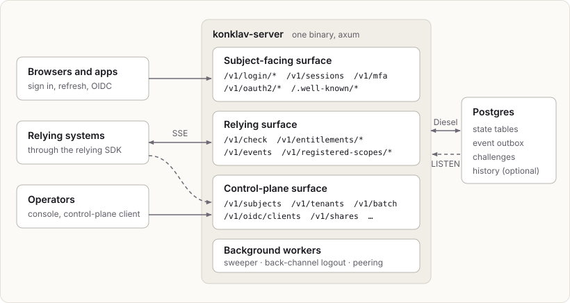
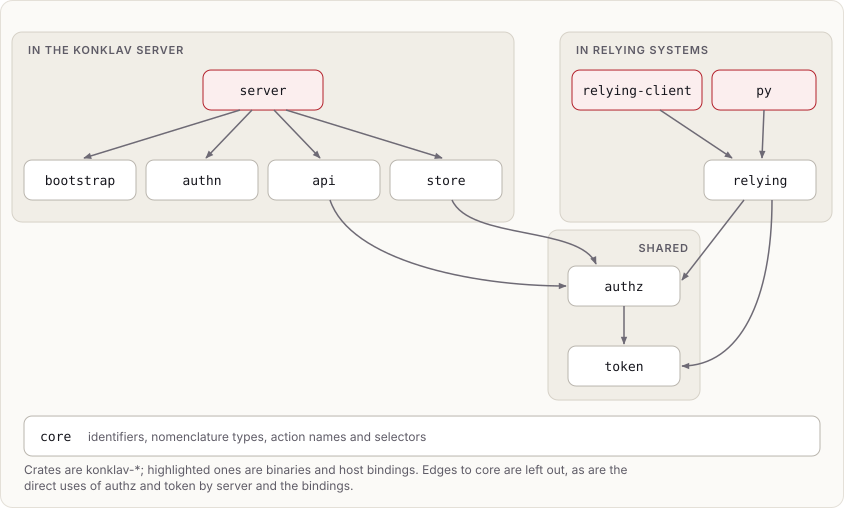

# Konklav overview

Status: accepted as direction. This note is not normative; the specs
in `docs/spec/` are.

## Why this design

The first version (tag `v1`) proved the domain model and the vocabulary, but three choices
made it hard to finish and hard to adopt:

- **Feldera as the authoritative store.** Append-only temporal tables,
  publish barriers and experimental transactions dominated the design.
  Testing needed a fake pipeline manager, and real-pipeline tests never
  landed.
- **Grant snapshots in access tokens (`az`).** Offline decisions are cheap,
  but grants then stay stale for the token's lifetime and tokens grow with
  the number of scopes. Relying systems that need fast revocation still had
  to call back.
- **Scope drift.** The history ended with a general-purpose configuration
  library. That work now lives in `ordna`, which Konklav uses.

This design keeps the vocabulary and the ideas that held up: subjects, tenants as a
tree with no implicit parent access, memberships, templates and roles,
compiled entitlements, actor chains, Ed25519 keys published through JWKS,
and spec-first development with Tracey.

## Decisions

| Area | Decision | Note |
|---|---|---|
| Storage | Postgres owned by Konklav, accessed with Diesel (`diesel-async`) | [storage](storage.md) |
| HTTP | axum, one binary, three separately routable surfaces | |
| Config | `ordna`, Styx files with secrets kept separate | |
| Tokens | Ed25519 JWTs that carry session data but no grants | [sessions and tokens](sessions-and-tokens.md) |
| Decisions | Relying SDK with a local entitlement cache, invalidated by the change feed, with the check API as fallback; fails closed | [entitlements and decisions](entitlements-and-decisions.md) |
| Feed | Transactional outbox served over SSE, resumable by cursor | [change feed](change-feed.md) |
| Relying SDK | Sans-I/O Rust core; pyo3 binding first, wasm later | [relying SDK](relying-sdk.md) |
| Tenants | Konklav is authoritative; relying systems keep projections | [tenant projections](tenant-projections.md) |
| Erasure | Konklav erases the personal data it holds and keeps the erased subject's id; relying systems hear it on the feed and erase theirs | [erasure](erasure.md) |
| Messaging | Konklav emits delivery requests; relying systems send the messages | [change feed](change-feed.md) |
| Federation | OIDC in both roles (identity providers and OpenID provider) with claim mapping; Konklav instances federate, optionally peering through the change feed | [OIDC and federation](oidc-and-federation.md), [proof of possession](proof-of-possession.md) |
| Managed config | Deferred; catalog and templates go through the control-plane API first | |

## Software items

| Item | Responsibility |
|---|---|
| `konklav-core` | Identifiers, nomenclature types, action names and selectors |
| `konklav-api` | Transport types of the HTTP surfaces, with their OpenAPI schemas |
| `konklav-store` | Diesel schema, migrations, repositories, event outbox |
| `konklav-authz` | Pure compilation of entitlement sets and evaluation of requirements |
| `konklav-token` | Access-token claims, EdDSA JWS signing and verification, JWKS (shared by the issuer and the relying core) |
| `konklav-authn` | Password and secret-key hashing, refresh tokens; TOTP and challenges later |
| `konklav-server` | axum surfaces, wiring, background workers |
| `konklav-relying` | Sans-I/O relying core |
| `konklav-relying-client` | Native Rust host binding (reqwest + tokio) |
| `konklav-axum` | axum integration of the native Rust host binding: route policies and rate limits |
| `konklav-py` | pyo3 host binding |
| `konklav-py-control-plane` | Python control-plane client (`konklav-control-plane`), with types generated from the API document |
| `konklav-py-fastapi` | FastAPI integration of the Python binding's route policies (`konklav-fastapi`) |
| `konklav-bootstrap` | Reading bootstrap sets (CSV or Styx) for `konklav-server bootstrap` |
| `konklav-console` | Browser UI for operators, calling the control plane (Leptos, WASM) |

Dependencies point inward: `server` → `api`/`store` → `authz` → `token` →
`core`, and `authn` depends only on `core`. `api` uses `authz` for the
authorization model's types; the server converts its models to `api`'s
transport types at the boundary.
`relying` depends only on `core`, `token` and `authz` (for evaluation), and
the bindings depend on `relying` and the crates it builds on.

The control-plane surface is authorized by built-in `konklav:`
capabilities that operators hold through global roles:

- `konklav:control:all`, or one per area: `subjects`, `tenants`, `authz`,
  `sessions`, `keys`, `invites`
- `konklav:subject:impersonate` and `konklav:delivery:read` for the
  matching flows

Konklav also ships built-in roles in the root tenant, under the reserved
`konklav.` key prefix. `konklav.admin` grants `konklav:control:all`, and
`konklav.delivery` grants `konklav:delivery:read` for the service principal
that delivers challenges. Built-in roles can be assigned, but they can't be
edited or deleted.

An optional bootstrap token from the secrets file is accepted for
everything. It exists to create the first operator and should then be
removed.

## Adoption path for an existing relying system

A relying system that already has its own authentication and authorization
typically adopts Konklav like this:

1. Introduce narrow ports in front of its current implementation.
2. Switch to asymmetric tokens.
3. Import its data with a one-off importer that preserves identifiers.
4. Replay a recorded corpus of decisions against the check API until there
   are no diffs.
5. Switch the ports over to Konklav.

Konklav's side of this is the import API (`/v1/import/*`, capability
`konklav:import`) plus the idempotent control-plane endpoints. Mapping
the relying system's tables onto them, and comparing its access decisions
with Konklav's entitlement sets, belongs in that system's own tooling.

Compilation semantics are pinned by golden tests
(`r[authz.compile.reference-semantics]`) so that a zero-diff replay stays
meaningful.
