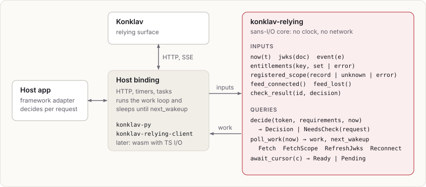

# Relying SDK

## Layers

The core is a state machine. Its inputs are:

- `now(t)`
- `jwks(doc)`
- `entitlements(key, set | error)`
- `registered_scope(record | unknown | error)`
- `event(e)`
- `feed_connected()` and `feed_lost()`
- `check_result(id, decision)`

Its outputs are queries:

- `decide(token, requirements, now) -> Decision | NeedsCheck(request)`
- `poll_work(now) -> [Fetch(key) | FetchScope(kind, id) | RefreshJwks | Reconnect]` together with
  `next_wakeup`
- `await_cursor(c) -> Ready | Pending`

Host bindings run a loop: they perform the work items, feed the results
back, and sleep until `next_wakeup` or until a new event arrives.

## Why sans-I/O

- One implementation of every rule that matters for security: signature
  checks, version checks, flag semantics, the debounce bound, and the
  fallback conditions. Bindings cannot drift apart
  (`r[item.relying.single-implementation]`).
- Deterministic tests: time and network are inputs, so the debounce,
  staleness and reset logic can be property-tested without sleeping.
- Portability: no tokio or reqwest in the core, so it compiles to `wasm32`.

## Audiences

A relying system may accept tokens for more than one audience: Konklav's
own, for subjects that sign in to Konklav directly (such as services with
secret keys), and those of the OIDC clients that sign people in to it
through the OpenID provider (`r[oidc.provider.client-audience]` keeps these
apart). The core's `Config` lists them as `audiences`, a token verifies if
its `aud` is any one of them, and the verified claims carry `aud` so the
relying system can treat the audiences differently
(`r[relying.verify.audiences]`). The hosts send the same list with every
check API call, so a decision through the check API accepts exactly the
tokens a local one does (`r[authz.api.check-audiences]`).

Accepting several audiences doesn't merge them: a relying system that
serves some operations only to one audience restricts those operations
itself, as the FastAPI integration's `RoutePolicy(audiences=...)` does.

## Bindings

- **Python (`konklav-py`, first):** pyo3 and maturin with abi3 wheels. The
  I/O layer is Python: an httpx client and an asyncio background task for
  the SSE stream and fetches. Decisions are synchronous calls into Rust
  under a short lock, so the request path does not cross threads.
- **Rust (`konklav-relying-client`):** reqwest and tokio.
- **JS (later):** a wasm build of the core with a small TS I/O layer, for
  Node services or browser-side UI gating. Browser use can only hide UI
  elements; enforcement always happens on the server.

Python does not use the wasm build. A long-lived SSE task and HTTP from
inside a wasm guest require wasi-http host support, which Python wasm
runtimes don't yet provide reliably. pyo3 also avoids a serialization
boundary on every decision.

## Framework adapters

Framework-specific glue (for example, a FastAPI dependency that turns
route-level requirements into `decide` calls) lives in the relying system or
in thin optional packages: `konklav-fastapi` for FastAPI and `konklav-axum`
for axum. The SDK exposes requirements, decisions and route policies.

Route policies merge by the same rules everywhere. In Rust the model lives
in the relying core (`konklav_relying::policy`), since merging decides which
flags and step-ups an operation admits, and every Rust integration builds on
it. The Python binding has its own framework-free `Policy` with the same
rules (`item.py.policy.*`).
