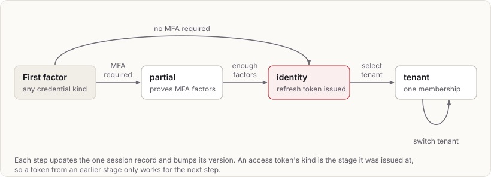

# Sessions and tokens

## Login stages



Every stage transition updates one session record and increases its
version. Tokens from earlier stages stop working for anything except the
next step, because their token kind is not accepted elsewhere.

## Session record

`session { id, subject, credential, tenant?, membership?, amr[], auth_time,
flags[], facts_snapshot, version, refresh_hash, refresh_family,
impersonator?, expires_at, revoked_at?, revoked_reason? }`

- Refresh rotation:
  1. Compare and swap on `refresh_hash`.
  2. If the presented token matches an older value in the same family,
     revoke the session (reuse detection).
- Revocation sets `revoked_at` and bumps `version` in one statement, then
  emits `session.changed`.

## MFA, step-up and impersonation

- A credential's `mfa_factors_required` makes login stop at a partial
  session. The partial session can list its active factors
  (`GET /v1/mfa`), and `POST /v1/login/mfa` proves one at a time. Once
  enough distinct factors are proven, the session becomes an identity
  session and gets its refresh token: in the body for native clients, as
  the cookie for browsers.
- Factors:
  - TOTP: the seed is encrypted with AES-256-GCM under configured keys,
    and replay is refused by remembering the last step.
  - Email codes: challenges.
- `amr` values: `pwd`, `otp` (TOTP), `eml` (email code or magic link),
  `sms` (phone code), `sk` (secret key or OIDC client secret), `swk` and
  `mfa` (a passkey), `fed` (an identity provider,
  plus whatever its `amr`/`acr` map to).
- Step-up (`POST /v1/step-up`) proves a factor or the password again in the
  same session. It adds the method, resets `auth_time` and bumps the
  version.
- Impersonation (`POST /v1/impersonate`) needs the
  `konklav:subject:impersonate` capability. It creates a child session for
  the target with `act` naming the impersonator. The child lasts at most an
  hour and never outlives its parent: revoking a session revokes its
  children.

## Challenges and delivery

Magic links, phone codes, email MFA codes, invites and password resets are
challenges:

- single-use and short-lived
- stored as SHA-256 of the challenge id and secret
- codes allow 5 attempts
- at most 5 are sent per recipient and purpose every 10 minutes

Each one appends `delivery.requested` with the material. Only service
principals holding `konklav:delivery:read` see those events, and the
material is stripped once the challenge has expired. Start endpoints always
answer 202, so they reveal nothing about which identifiers exist.

## Response pacing

Endpoints whose timing could reveal whether an identifier exists are paced.
These are first-factor login, MFA completion, step-up, the passwordless and
password-reset start and complete pairs, password change and invite
redemption:

- A middleware starts a timer of 1.5 s ± 0.25 s (configurable under
  `pacing`) when the request arrives, and responds when both the timer and
  the handler are done.
- The handler's work runs during the wait, so the floor costs nothing when
  the work is slower. The wait holds no database connection.
- The dummy hash for unknown identifiers stays. It keeps CPU cost even, so
  paced responses don't leak through load.
- Refresh, tenant selection, sign-out and factor management are not paced:
  they need a valid session or token, which an attacker probing for
  accounts doesn't have.

## Session flags

Flags are catalog-declared labels that Konklav copies into `sfl` without
interpreting them.

- **Restrictive** flags (for example, a session limited to a subject's
  personal tenant) deny by default. A relying operation must admit the flag
  explicitly.
- **Assertive** flags (for example `device_bound`) are positive claims that
  an operation can require.

A flag is set only by:

- catalog rules attached to a credential kind or login endpoint
- the credential itself: restrictive flags set on it with
  `PUT /v1/credentials/{id}/session-flags` (or by import or bootstrap) go
  into every session started with it, so a relying system can keep, say,
  email-link sessions to a personal tenant whatever the client asks for
- an explicit login request parameter that the catalog permits
- a step-up flow that the catalog permits (for example, a hardware-key
  proof sets `device_bound`)

Relying systems never set or clear flags on existing sessions.

### Confinements

A restrictive flag can carry a confinement in the catalog: the tenants a
session carrying it may act in, given as allowed values of portable tenant
facts.

```json
{"name": "personal_only", "kind": "restrictive", "requestable": true,
 "confine": {"tenant": {"tenant_type": ["personal"]}}}
```

Admitting the flag lets an operation run for the session; the confinement
says where. Konklav enforces it in two places:

- **Entering a tenant:** `login/tenant` refuses a non-matching tenant, and
  no tenant token is issued (on refresh, or to an OpenID Connect client)
  while the session's tenant doesn't match. A refused refresh rotates
  nothing, so the session recovers if the tenant matches again.
- **Deciding:** a decision for a confined session denies with
  `confined_session` when its tenant doesn't match now, or when the token
  targets no tenant. Global actions don't lift that deny. Entitlement sets
  carry the confinements and the tenant's portable facts, and changing a
  tenant's facts emits `entitlements.changed` for the tenant, so a relying
  core decides from current facts rather than the token's.

An operation can match tenant facts the same way without a flag, as a
requirement: `{"tenant_facts": {"tenant_type": ["client"]}}` denies with
`{"tenant_facts": {"fact": "tenant_type"}}` unless the token's tenant is a
client tenant now. Since a cached entitlement set can't know which
requirements it will meet, it carries every portable tenant fact, which
`fact.bounded` keeps small.

Confinements are deliberately small: each predicate matches one string,
integer or boolean fact against a list of values, and all must hold. A
general policy language (CEL, Cedar, Starlark) would break what Konklav
relies on: compiled entitlement sets, decision explanations that name the
rule, escalation checks and change-feed invalidation.

## Browser clients

- The refresh token is a cookie named `__Host-konklav_refresh` with these
  attributes:
  - `HttpOnly; Secure; SameSite=Strict`
  - `Path=/` and no `Domain`, which the `__Host-` prefix requires
  - scoped to Konklav's exact host: browsers refuse a `__Host-` cookie
    from any other host, including a sibling subdomain, and from plain
    HTTP, so nobody can plant a refresh token of their own
- Every cookie Konklav sets follows the same rule. A path-scoped cookie
  would be sent to fewer endpoints, but could be replaced from a sibling
  subdomain. Only `/v1/refresh` and `/v1/sign-out` read the refresh
  cookie, and `SameSite=Strict` keeps it off cross-site requests. With
  `secure_cookies false` (local development over HTTP) the names drop
  the prefix, which browsers only accept on secure cookies.
- The access token is returned in the body and kept in memory by the
  frontend. A reload calls `/v1/refresh` to get a new one.
- `SameSite=Strict` requires the frontend and Konklav to share a
  registrable domain (for example `app.example` and `auth.example`).
- CSRF defence in depth: an `Origin` allow-list plus a required custom
  header (for example `X-Konklav-Client: web`), which forces a CORS
  preflight.
- Non-browser clients use body tokens. The login endpoint variant or an
  explicit `client=browser|native` parameter chooses between the two.
- Every interactive login takes `client` and `flags` in the same way:
  `POST /v1/login/password`, `/v1/login/email-link/complete`,
  `/v1/login/phone/complete` and `/v1/invites/redeem`. So a login
  application can keep one single sign-on session in the cookie however
  the person proves who they are. The browser checks and the flags are
  checked before the password, code, link or invite is, so a refused
  request leaves a code or link usable.
- The email link takes them on `complete`, not on `start`. The link is
  often opened in another browser, or in a mail app's web view, than the
  one that asked for it. The client that redeems it is the one that holds
  the session, so it must be the one that passes the browser checks and
  gets the cookie. A choice recorded at `start` could only be refused
  there or, worse, deliver a session to the wrong kind of client.
  Restrictive flags only narrow a session, so letting the redeeming
  client choose them gives it nothing that an unflagged login wouldn't. A
  flag that every session of a credential must carry belongs on the
  credential (`PUT /v1/credentials/{id}/session-flags`).

## Signing keys

- Private keys come from secret files; at most one is active for signing at
  a time.
- Public-key history is stored in Postgres with
  `published_at, activated_at, retired_at, revoked_at`.
- Rotation:
  1. Load and publish the new key.
  2. Activate it once relying JWKS caches have had time to refresh
     (`signing_keys.changed` speeds this up).
  3. Retire the old key and keep it published until `retired_at` + maximum
     token TTL.
- Break-glass: mark the key revoked and remove it from JWKS immediately.
  Issuance fails with `SIGNING_KEY_UNAVAILABLE` until another key is
  active.
