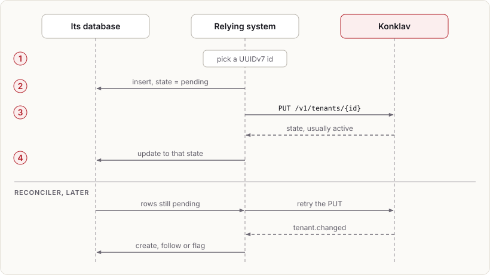

# Tenant projections in relying systems

Konklav is authoritative for tenant existence, parentage and state
(`r[tenant.authority]`). Relying systems usually need a local tenant row
anyway, for profile data and as the target of their own foreign keys. This
note describes the recommended pattern.

## Creating a tenant

1. The relying system picks a UUIDv7 `id`.
2. In its own transaction, it inserts its projection row with
   `state = pending` and its profile data.
3. It calls `PUT /v1/tenants/{id}` with the parent, facts and optional
   templates to instantiate roles from. The call is idempotent on `id`.
4. It updates its row to the state Konklav returned (usually `active`).

The relying system's own flows always read its local row, so they never wait
for the feed (read-your-writes by construction).

## Failure handling

- **Failure between steps 2 and 3, or 3 and 4.** A reconciler retries
  `PUT /v1/tenants/{id}` for rows still `pending` after a timeout. Because
  the call is idempotent, retrying is always safe.
- **A tenant created in Konklav by someone else** (an operator, or a
  different relying system). The reconciler consumes `tenant.changed`
  events and either creates a projection row or flags the mismatch,
  depending on the relying system's policy.
- **State changes** (suspend, delete) arrive through `tenant.changed`, and
  the projection follows. Each side decides when to hard-delete its own
  data.

## Signup flows

Self-service signup that creates a subject, a tenant and a membership in one
step uses the same pattern. The relying system writes its pending
projection rows first, then makes one Konklav call that creates subject,
tenant and membership atomically. It completes its own side, such as
domain-specific records keyed by the membership id, once that call returns.
