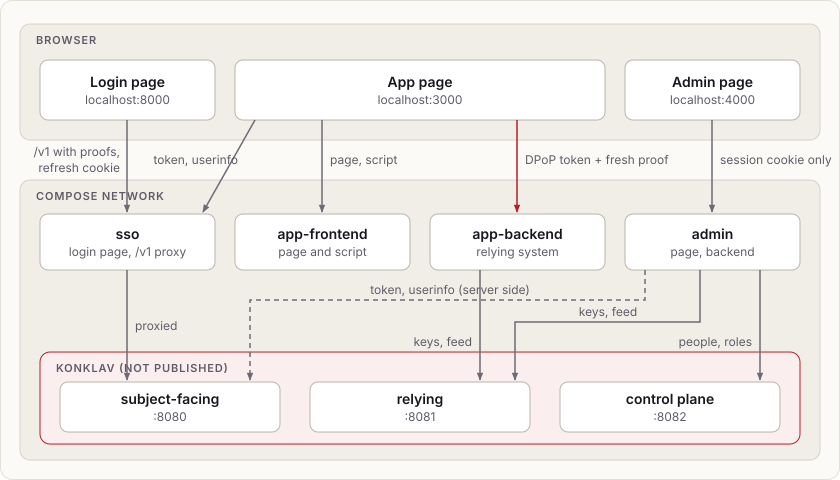
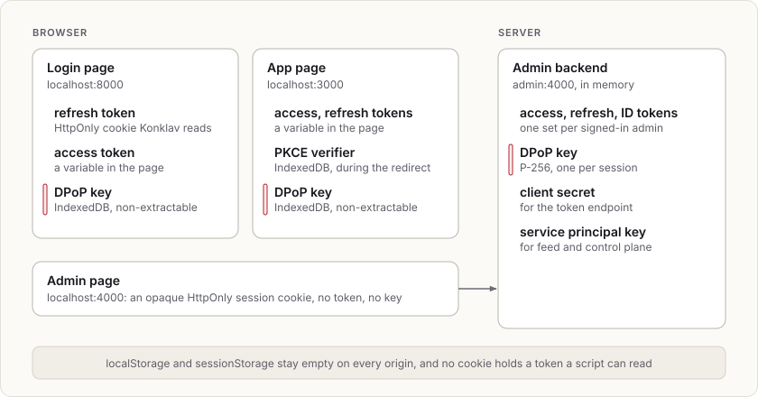
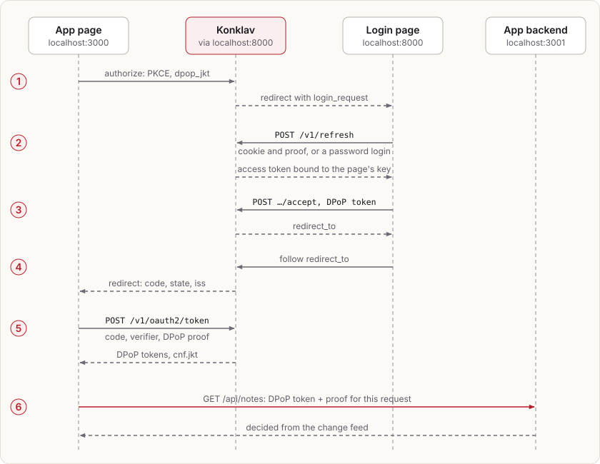

# The notes app

Konklav's showcase example: one complete app, in Docker Compose. Konklav signs people in to two applications with one sign-in:

- a notes app: a browser page with its own API
- an admin page, which manages people, roles and sessions

Every token is sender-constrained with DPoP (RFC 9449), and no token is ever written to `localStorage` or `sessionStorage`. In the Python version the API runs as two replicas behind a load balancer, and both it and the admin page rate limit writes through Valkey, which speaks Redis' protocol.

What it leaves out, the [scenario examples](../README.md#scenarios) show: federation, bootstrap sets, email delivery and DPoP on its own.

The example comes in two versions with the same services, ports, people and behaviour. Pick one:

```sh
docker compose -f examples/notes-app/python/compose.yaml up --build
docker compose -f examples/notes-app/rust/compose.yaml up --build
```

- **Python** uses the `konklav-relying`, `konklav-fastapi` and `konklav-control-plane` packages. The app backend is a FastAPI app with route policies and rate limits; the other services use Starlette.
- **Rust** uses the `konklav-axum` and `konklav-relying-client` crates, with axum and reqwest. Its app backend has the same route policies and rate limits, but runs once and keeps notes in memory.

Both run the same browser code, from [`web/`](web), since DPoP keys have to be made in the page with WebCrypto. They use the same ports, so run one at a time. Each keeps its own volumes.

The first build compiles `konklav-server` from this checkout, and the Python version also compiles `konklav-relying`. That takes a few minutes. Then open:

- <http://localhost:3000>: the notes app
- <http://localhost:4000>: the admin page

Sign in as `ada@example.com` / `correct horse battery`, an admin and editor, or `bob@example.com` / `bob's long password`, a member. To start over, run `down -v` with the same `-f`.

## The services



| Service | Port | What it is |
|---|---|---|
| `konklav` | internal | Konklav, as an OpenID provider. Its surfaces stay on the Compose network. |
| `sso` | 8000 | The login application. It serves the login page and proxies Konklav's subject-facing surface, so Konklav's issuer is `http://localhost:8000`. |
| `app-frontend` | 3000 | The app's page. A public OIDC client, `app`. |
| `app-backend` | 3001 | The app's API. A relying system for the `app-api` audience. In Python, two replicas behind `app-api`, a Caddy load balancer that publishes the port. |
| `admin` | 4000 | The admin page: its frontend and backend in one process. A confidential OIDC client, `admin`. |
| `valkey` | internal | The rate-limit store the app backend (in Python, its replicas) and the admin page share. |
| `postgres`, `keys`, `migrate`, `setup` | | Postgres (Konklav's database, and in Python the notes' own `notes` database), Konklav's signing keys, its migrations, and seeding over the control plane: catalog, roles, people, clients and service principals. |

| | Python ([`python/services`](python/services)) | Rust ([`rust/src/bin`](rust/src/bin)) |
|---|---|---|
| `sso` | `sso/app.py` | `login.rs` |
| `app-frontend` | `app-frontend/server.py` | `app_frontend.rs` |
| `app-backend` | `app-backend/api.py` | `app_backend.rs` |
| `admin` | `admin/admin.py` | `admin.rs` |
| `setup`, `keys` | `setup/setup.py`, `setup/keys.py` | `setup.rs`, `keys.rs` |

## Where the tokens are



- **Browser keys.** Each page's DPoP key is a WebCrypto P-256 key, created non-extractable and kept in that origin's IndexedDB ([`web/shared/dpop.js`](web/shared/dpop.js)). A script on the page can sign with it but can't read it out. So a stolen token is worthless away from the page.
- **Reloads.** On a reload the app's tokens are gone. The app asks Konklav again with `prompt=none`, and the login page restores its session from the cookie and accepts without showing anything. The PKCE verifier waits in IndexedDB during that redirect and is deleted on return.
- **Konklav's settings** ([`konklav/config.styx`](konklav/config.styx)):
  - `browser { require_dpop true }` refuses login-page sessions without a key.
  - `oidc_provider { require_dpop all }` refuses tokens to any client without a proof.

## The flows



**Signing in to the app**

1. The app redirects to `/v1/oauth2/authorize` with PKCE and `dpop_jkt`, the thumbprint of its key.
2. Konklav hands the browser to the login page with `login_request`. The login page restores its own Konklav session (`/v1/refresh`), or signs in (`/v1/login/password` with `client: browser`), with a proof on every request.
3. It accepts the request with its DPoP-bound token.
4. The browser follows `redirect_to` and comes back to the app with a code.
5. The app exchanges the code with a proof, so Konklav returns `token_type: DPoP` tokens with `cnf.jkt`.
6. It calls its API with the token and a fresh proof.

**Calling the API.** Each request carries `Authorization: DPoP <token>` and a proof for its method and URL. The backend passes the raw headers and its public URL to the relying client, which:
- checks the proof, and refuses a replayed one
- verifies the token offline
- decides `notes:read` or `notes:write` from entitlements it keeps current from Konklav's change feed

Each notes route declares its action as a route policy, and the decision is made before the route runs: by `konklav-fastapi`'s `RoutePolicy` dependencies in Python, and by `konklav-axum`'s `RoutePolicy` layers in Rust.

A proof is accepted once, so each decision is its own request: the app asks `/api/can/notes:read` and `/api/can/notes:write` separately. The action comes from the path there, so that route is public and decides itself.

**The admin page.** The admin backend runs the same code flow, but server side:
- It authenticates with its client secret, binds the tokens to a key only it holds, and refreshes them with that key.
- On every API request it asks its own relying client for `admin:access`, presenting the token with a proof it signs. The browser never sees either.
- What admins change goes through the control plane as the `admin-api` service principal. That principal holds only `konklav:subjects:manage`, `konklav:authz:manage` and `konklav:sessions:manage`.

**Single logout.** Signing out of either app is RP-initiated logout (`/v1/oauth2/logout`). It ends the login page's session, and with it every client session started from it. The other app's next request is refused as `invalid_token`.

## Rate limits

Both versions limit writes the same way, under the same limit names. Python uses `konklav_relying.RateLimit` in both of `konklav-fastapi`'s styles:

- **On a route.** Adding a note takes `RouteRateLimit(note_writes, "{token:sub}")` next to its `RoutePolicy` ([`app-backend/api.py`](python/services/app-backend/api.py)): five notes at once per person, then one every 12 seconds. It counts after the policy allowed the request, keyed by the verified token's subject.
- **In code.** The admin page calls `await admin_writes.add(address)` on every write before it looks up the session ([`admin/admin.py`](python/services/admin/admin.py)): ten at once per client address, then one every 6 seconds. The address is `KonklavRoutes.client_address`, with no `trusted_proxies` since nothing stands in front of the admin page; behind a proxy, list it there and the address comes from `X-Forwarded-For`. On Docker Desktop every browser connection comes from the same gateway address, so the limit is effectively shared.

Rust does the same with `konklav_relying_client::rate_limit::RateLimit` and `konklav-axum` ([`app_backend.rs`](rust/src/bin/app_backend.rs), [`admin.rs`](rust/src/bin/admin.rs)): the notes route's `RoutePolicy` carries `.rate_limit(RouteRateLimit::new(note_writes, "{token:sub}")?)`, and the admin page calls `admin.writes.add(address).await` with the peer's address. Its backend runs once, so its limit keeps the default `local_divisor` of 1.

A refused write is `429` with `{"error": {"code": "rate_limited"}}` and a `Retry-After` in whole seconds, with jitter so clients refused together don't retry together. In Python, the app backend's `KonklavRoutes.install` registers that handler, and the admin page, a Starlette app, registers the same `handle_rate_limited`. In Rust, `konklav-axum` answers `Denied::RateLimited` so, and the admin page answers with `retry_after_seconds`. The browser reads `Retry-After` (exposed through CORS for the app's API) and says when to try again; the app also keeps its **Add** button disabled until then.

Both limits share state through Valkey, so the app backend's two replicas count together; any rate-limit store works, Valkey or Redis 6.2 or later, reached with a `redis://` URL and the `redis` client library (`konklav-relying[redis]` in Python, `konklav-relying-client`'s `redis` feature in Rust). Keys are hashed under `rate_limit_secret`, 32 random bytes the setup service writes to the shared secrets file next to the other secrets, so every process has the same one. Every process also counts in memory. While Valkey fails, each answers from that, leaving it alone for a backoff of one second growing to 30. With `local_divisor=2`, the backend's replicas then allow two notes at once each, rather than five each, so together they stay near the limit.

**Pacing.** `konklav-fastapi` and `konklav-axum` also pace routes (`RoutePacing`) and make fake ids, so that an answer's timing and ids don't show whether a record exists, as when inviting an unknown address. No route here needs it: the app's and the admin page's routes answer signed-in people only, and sign-in goes through Konklav, which paces its own. Their READMEs show where it belongs.

## Things to try

- **DPoP.** In the app, **What DPoP stops** sends the access token without a proof, then replays a captured request. Both get `401` with `WWW-Authenticate: DPoP error="invalid_dpop_proof"`.
- **Live roles.** As Ada on the admin page, take away Ada's `editor` role. In the app, **Check again** shows `notes:write` gone, and adding a note is refused.
- **Revocation.** Use **Sign out everywhere** for someone signed in to the app; their next API call is refused and the refresh fails.
- **Single sign-on.** Sign in to the app, then open the admin page: it signs you in without a prompt. As Bob it says the page is for admins only.
- **Rate limits.** As Ada, add six notes quickly: the sixth is refused, and the page counts down to the next. In Python, the page names the backend replicas that answered it under the notes. Then, in Python, stop Valkey with `docker compose -f examples/notes-app/python/compose.yaml stop valkey` and add notes again: each replica now counts alone and allows two at once, then one every 30 seconds, so the limit still holds, and the backends log that they answer from memory. Start it again with `start valkey`; after the backoff, at most 30 seconds, the replicas count together through Valkey again, from a fresh count since Valkey kept nothing.
- **Storage.** In either page's developer tools, `localStorage`, `sessionStorage` and `document.cookie` are empty. IndexedDB holds only the `CryptoKey`.

## Layout

- `konklav/`: Konklav's configuration and example-only secrets, shared by both versions.
- `web/`: the pages and scripts the browser runs. The Python services serve them from disk; the Rust binaries compile them in.
- `python/`: `compose.yaml`, the image's `Dockerfile`, `services/`, the load balancer's `Caddyfile`, `notes-database.sql`, which creates the notes' database, and `smoke.sh`, which CI runs against the running stack.
- `rust/`: `compose.yaml`, the image's `Dockerfile` and the `konklav-sso-example` crate, a workspace member, so `cargo clippy --workspace` checks it.
- `diagrams/`: the diagrams above.

## Not production-ready

- **HTTP.** Everything runs on `localhost` over plain HTTP with `secure_cookies false`. Over HTTPS, the login page's cookie becomes `__Host-konklav_refresh`.
- **Shared cookies.** Cookies on `localhost` are shared by every port, which is why the admin page's cookie names are specific. Real deployments put each app on its own host under one registrable domain, since Konklav's cookie is `SameSite=Strict`.
- **In-memory state.** The admin backend keeps sessions in memory, so a restart signs people out of it. The Rust app backend keeps notes in memory.
- **Secrets.** The bootstrap token in `konklav/secrets.styx` grants everything; real deployments remove it once an operator exists. The setup service writes the client secret and service-principal keys to a shared volume.
- **Sign-in methods.** The login page signs in with a password only. It doesn't implement MFA, passkeys, or email links and phone codes (which can start its browser session as password sign-in does, but need a delivery worker such as the [`smtp-delivery`](../README.md#smtp-delivery) scenario's). Nor does it set up the `X-Forwarded-For` handling (`listen.trusted_proxies`) that Konklav's own per-address rate limits need behind its proxy.
- **Valkey.** It runs without a password or TLS on the Compose network, and keeps nothing on disk, which is enough for rate-limit state.
- **Back-channel logout.** It isn't used: the admin backend learns of ended sessions from the relying client's decisions instead.
