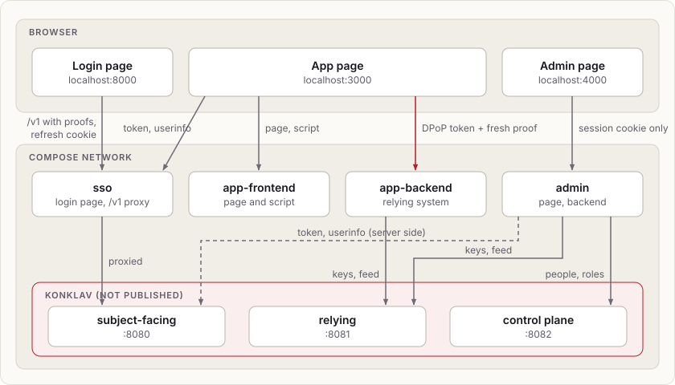
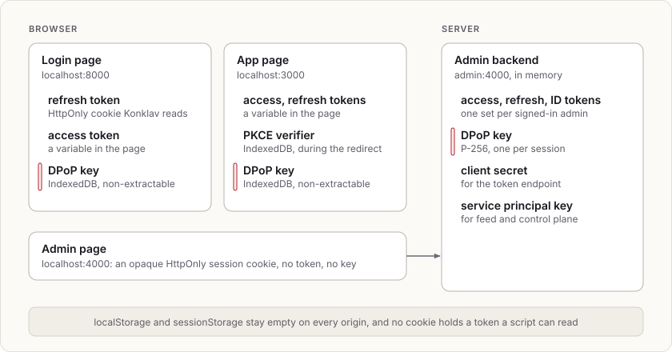
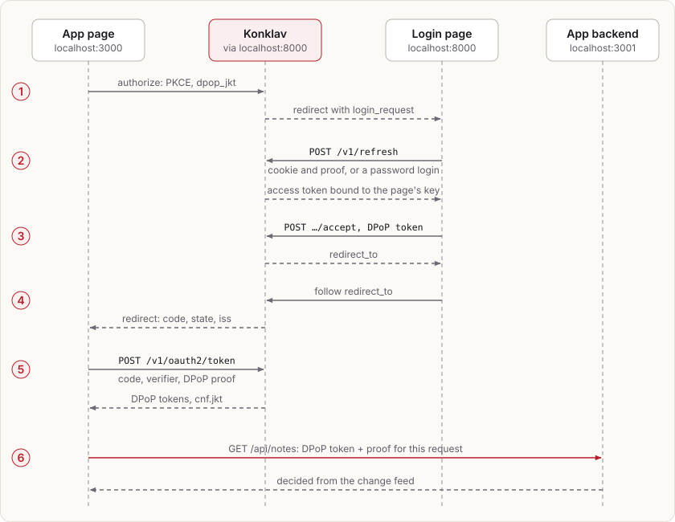

# Single sign-on with DPoP, in Docker Compose

Konklav signs people in to two applications with one sign-in:

- a browser app with its own API
- an admin page

Every token is sender-constrained with DPoP (RFC 9449), and no token is ever written to `localStorage` or `sessionStorage`.

The example comes in two versions with the same services, ports, people and behaviour. Pick one:

```sh
docker compose -f examples/sso-compose/python/compose.yaml up --build
docker compose -f examples/sso-compose/rust/compose.yaml up --build
```

- **Python** uses the `konklav-relying`, `konklav-fastapi` and `konklav-control-plane` packages. The app backend is a FastAPI app with route policies; the other services use Starlette.
- **Rust** uses the `konklav-relying-client` crate, with axum and reqwest. Konklav has no axum integration, so its app backend decides each request itself.

Both run the same browser code, from [`web/`](web), since DPoP keys have to be made in the page with WebCrypto. They use the same ports, so run one at a time. Each keeps its own volumes.

The first build compiles `konklav-server` from this checkout, and the Python version also compiles `konklav-relying`. That takes a few minutes. Then open:

- <http://localhost:3000>: the notes app
- <http://localhost:4000>: the admin page

Sign in as `ada@example.com` / `correct horse battery`, an admin and editor, or `bob@example.com` / `bob's long password`, a member. To start over, run `down -v` with the same `-f`.

## The services



| Service | Port | What it is |
|---|---|---|
| `konklav` | internal | Konklav, as an OpenID provider. Its surfaces stay on the Compose network. |
| `sso` | 8000 | The login application. It serves the login page and proxies Konklav's subject-facing surface, so Konklav's issuer is `http://localhost:8000`. |
| `app-frontend` | 3000 | The app's page. A public OIDC client, `app`. |
| `app-backend` | 3001 | The app's API. A relying system for the `app-api` audience. |
| `admin` | 4000 | The admin page: its frontend and backend in one process. A confidential OIDC client, `admin`. |
| `postgres`, `keys`, `migrate`, `setup` | | Postgres, Konklav's signing keys, its migrations, and seeding over the control plane: catalog, roles, people, clients and service principals. |

| | Python ([`python/services`](python/services)) | Rust ([`rust/src/bin`](rust/src/bin)) |
|---|---|---|
| `sso` | `sso/app.py` | `login.rs` |
| `app-frontend` | `app-frontend/server.py` | `app_frontend.rs` |
| `app-backend` | `app-backend/api.py` | `app_backend.rs` |
| `admin` | `admin/admin.py` | `admin.rs` |
| `setup`, `keys` | `setup/setup.py`, `setup/keys.py` | `setup.rs`, `keys.rs` |

## Where the tokens are



- **Browser keys.** Each page's DPoP key is a WebCrypto P-256 key, created non-extractable and kept in that origin's IndexedDB ([`web/shared/dpop.js`](web/shared/dpop.js)). A script on the page can sign with it but can't read it out. So a stolen token is worthless away from the page.
- **Reloads.** On a reload the app's tokens are gone. The app asks Konklav again with `prompt=none`, and the login page restores its session from the cookie and accepts without showing anything. The PKCE verifier waits in IndexedDB during that redirect and is deleted on return.
- **Konklav's settings** ([`konklav/config.styx`](konklav/config.styx)):
  - `browser { require_dpop true }` refuses login-page sessions without a key.
  - `oidc_provider { require_dpop all }` refuses tokens to any client without a proof.

## The flows



**Signing in to the app**

1. The app redirects to `/v1/oauth2/authorize` with PKCE and `dpop_jkt`, the thumbprint of its key.
2. Konklav hands the browser to the login page with `login_request`. The login page restores its own Konklav session (`/v1/refresh`), or signs in (`/v1/login/password` with `client: browser`), with a proof on every request.
3. It accepts the request with its DPoP-bound token.
4. The browser follows `redirect_to` and comes back to the app with a code.
5. The app exchanges the code with a proof, so Konklav returns `token_type: DPoP` tokens with `cnf.jkt`.
6. It calls its API with the token and a fresh proof.

**Calling the API.** Each request carries `Authorization: DPoP <token>` and a proof for its method and URL. The backend passes the raw headers and its public URL to the relying client, which:
- checks the proof, and refuses a replayed one
- verifies the token offline
- decides `notes:read` or `notes:write` from entitlements it keeps current from Konklav's change feed

In Python, each notes route declares its action as a `RoutePolicy`, and `konklav-fastapi` makes the decision before the route runs. In Rust, each route calls `decide_request` itself.

A proof is accepted once, so each decision is its own request: the app asks `/api/can/notes:read` and `/api/can/notes:write` separately. The action comes from the path there, so that route is public and decides itself.

**The admin page.** The admin backend runs the same code flow, but server side:
- It authenticates with its client secret, binds the tokens to a key only it holds, and refreshes them with that key.
- On every API request it asks its own relying client for `admin:access`, presenting the token with a proof it signs. The browser never sees either.
- What admins change goes through the control plane as the `admin-api` service principal. That principal holds only `konklav:subjects:manage`, `konklav:authz:manage` and `konklav:sessions:manage`.

**Single logout.** Signing out of either app is RP-initiated logout (`/v1/oauth2/logout`). It ends the login page's session, and with it every client session started from it. The other app's next request is refused as `invalid_token`.

## Things to try

- **DPoP.** In the app, **What DPoP stops** sends the access token without a proof, then replays a captured request. Both get `401` with `WWW-Authenticate: DPoP error="invalid_dpop_proof"`.
- **Live roles.** As Ada on the admin page, take away Ada's `editor` role. In the app, **Check again** shows `notes:write` gone, and adding a note is refused.
- **Revocation.** Use **Sign out everywhere** for someone signed in to the app; their next API call is refused and the refresh fails.
- **Single sign-on.** Sign in to the app, then open the admin page: it signs you in without a prompt. As Bob it says the page is for admins only.
- **Storage.** In either page's developer tools, `localStorage`, `sessionStorage` and `document.cookie` are empty. IndexedDB holds only the `CryptoKey`.

## Layout

- `konklav/`: Konklav's configuration and example-only secrets, shared by both versions.
- `web/`: the pages and scripts the browser runs. The Python services serve them from disk; the Rust binaries compile them in.
- `python/`: `compose.yaml`, the image's `Dockerfile` and `services/`.
- `rust/`: `compose.yaml`, the image's `Dockerfile` and the `konklav-sso-example` crate, a workspace member, so `cargo clippy --workspace` checks it.
- `diagrams/`: the diagrams above.

## Not production-ready

- **HTTP.** Everything runs on `localhost` over plain HTTP with `secure_cookies false`. Over HTTPS, the login page's cookie becomes `__Host-konklav_refresh`.
- **Shared cookies.** Cookies on `localhost` are shared by every port, which is why the admin page's cookie names are specific. Real deployments put each app on its own host under one registrable domain, since Konklav's cookie is `SameSite=Strict`.
- **In-memory state.** The admin backend keeps sessions in memory, so a restart signs people out of it. The app backend keeps notes in memory.
- **Secrets.** The bootstrap token in `konklav/secrets.styx` grants everything; real deployments remove it once an operator exists. The setup service writes the client secret and service-principal keys to a shared volume.
- **MFA.** The login page doesn't implement MFA, passkeys, or the `X-Forwarded-For` handling (`listen.trusted_proxies`) that per-address rate limits need behind its proxy.
- **Back-channel logout.** It isn't used: the admin backend learns of ended sessions from the relying client's decisions instead.
